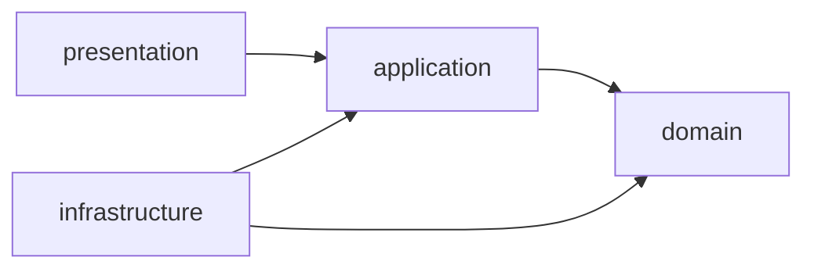

# Arquitectura

Este documento describe la estructura del proyecto y las reglas que la mantienen ordenada. Se actualiza cuando cambian los módulos o las reglas.

> La decisión de fondo (por qué un monolito modular y por qué separar dominio e infraestructura) se registrará en el ADR-0001, tarjeta F1-07.

## 1. Visión general

Timonel es un **monolito modular**: una sola aplicación desplegable, dividida en módulos por dominio con límites claros entre sí. Cada módulo se organiza internamente en cuatro capas.

El objetivo de esta organización es doble:

- Poder probar las reglas de negocio (SLA, estados, reglas de automatización) **sin base de datos** ni servicios externos.
- Poder cambiar o ampliar piezas (por ejemplo un canal de notificación) sin tocar la lógica de negocio.

## 2. Mapa de módulos

| Módulo          | Responsabilidad                                                                 | Fase |
| --------------- | ------------------------------------------------------------------------------- | ---- |
| `identity`      | Quién es el usuario y qué puede hacer: cuentas, autenticación, roles y permisos | 1    |
| `audit`         | Registro de operaciones sensibles                                               | 1    |
| `tickets`       | Tickets, comentarios, adjuntos, historial y ciclo de vida                       | 2    |
| `assignment`    | Equipos, agentes y estrategias de asignación                                    | 3    |
| `sla`           | Políticas, calendarios, plazos, alertas y escalamiento                          | 4    |
| `automation`    | Reglas de automatización y campos personalizados                                | 5    |
| `knowledge`     | Base de conocimiento                                                            | 6    |
| `notifications` | Correo y webhooks                                                               | 6    |
| `reporting`     | Reportes y exportaciones                                                        | 7    |

Los módulos se crean cuando llega su fase. La lista puede ajustarse durante el desarrollo.

### Qué NO pertenece a `identity`

- El **solicitante** (quien reporta un problema) es parte del dominio de `tickets`. Puede existir sin cuenta de usuario, así que su ficha y su cuenta de acceso son conceptos distintos, relacionados solo por un identificador opcional.
- El **agente como profesional** (habilidades, capacidad, turnos) pertenece a `assignment`. En `identity` solo existe su cuenta y su rol.
- La **auditoría** es un módulo propio. `identity` le informa de eventos, pero no guarda ni consulta ese registro.

## 3. Estructura de un módulo

```text
src/modules/<modulo>/
├── domain/
├── application/
├── infrastructure/
├── presentation/
├── <modulo>.module.ts
└── index.ts
```

| Capa              | Contiene                                                                                 | Puede importar                                       | No puede importar                       |
| ----------------- | ---------------------------------------------------------------------------------------- | ---------------------------------------------------- | --------------------------------------- |
| `domain/`         | Entidades, objetos de valor, reglas puras, errores de dominio                            | Solo TypeScript y otros archivos de `domain/`        | NestJS, ORM, Redis, colas, otras capas  |
| `application/`    | Casos de uso y **puertos** (interfaces como `TicketRepository` o `MailSender`)           | `domain/`                                            | `infrastructure/`, `presentation/`, ORM |
| `infrastructure/` | **Adaptadores** que implementan los puertos: repositorios, colas, correo, almacenamiento | `application/`, `domain/`, librerías externas        | `presentation/`                         |
| `presentation/`   | Controladores, DTOs, guards y decoradores                                                | `application/` y tipos de `domain/` (enums, errores) | `infrastructure/`                       |

`<modulo>.module.ts` es el módulo de NestJS: conecta los puertos con sus adaptadores mediante inyección de dependencias. `index.ts` es la **API pública** del módulo.

### Dirección de las dependencias



El dominio no depende de nadie. La infraestructura depende de la aplicación (implementa sus puertos), y no al revés. Ese es el punto clave: gracias a él, los casos de uso se prueban con un adaptador en memoria y el dominio se prueba sin ningún adaptador.

## 4. Reglas entre módulos

1. **Un módulo no lee las tablas de otro.** Cada módulo es dueño de sus datos.
2. **Un módulo no importa archivos internos de otro.** Solo importa lo que el otro expone en su `index.ts`.
3. **Las referencias entre módulos se hacen por identificador**, no por claves foráneas hacia tablas de otro módulo.
4. **La comunicación entre módulos** se hace llamando a los casos de uso expuestos en `index.ts` o mediante eventos de dominio (estos se introducen en fases posteriores).
5. **Las dependencias fluyen en un solo sentido.** Por ejemplo, `tickets` puede conocer a `identity` (por identificadores de usuario), pero `identity` no debe conocer a `tickets`. Si ocurre, algo está mal ubicado.

## 5. Cómo se vigila

### Regla de lint sobre `domain/` (Oxlint)

El proyecto usa **Oxlint** como linter. Impide que el dominio importe frameworks o infraestructura. Agrega este objeto al arreglo `overrides` de `.oxlintrc.json` (si el archivo ya tiene `overrides`, añádelo a la lista existente):

```json
{
  "overrides": [
    {
      "files": ["src/modules/*/domain/**/*.ts"],
      "rules": {
        "no-restricted-imports": [
          "error",
          {
            "patterns": [
              {
                "group": ["@nestjs/*"],
                "message": "El dominio no puede depender de NestJS."
              },
              {
                "group": ["typeorm", "typeorm/*"],
                "message": "El dominio no puede depender de TypeORM."
              },
              {
                "group": ["ioredis"],
                "message": "El dominio no puede depender de Redis."
              },
              {
                "group": ["bullmq"],
                "message": "El dominio no puede depender de bullmq."
              },
              {
                "group": [
                  "**/application/**",
                  "**/infrastructure/**",
                  "**/presentation/**"
                ],
                "message": "El dominio no puede importar otras capas."
              }
            ]
          }
        ]
      }
    }
  ]
}
```

Notas:

- `group` usa patrones al estilo `.gitignore`. En una misma entrada no se puede combinar `group` con `regex`.
- `@nestjs/typeorm` y `@nestjs/bullmq` ya quedan cubiertos por el patrón `@nestjs/*`. Si se incorpora otra librería de infraestructura, agrégala a la lista.
- Oxlint lee `.oxlintrc.json` (admite comentarios) o `oxlint.config.ts`, pero solo uno de los dos por directorio.

### Cómo comprobar que funciona

Crea temporalmente en `domain/` un archivo con `import { Injectable } from '@nestjs/common';` y ejecuta `pnpm lint`: debe fallar con el mensaje de la regla. Después elimina el archivo.

### Reglas que por ahora se vigilan con revisión

Las reglas entre módulos (sección 4) y las de la capa `application/` y `presentation/` se cumplen por convención y revisión de los pull requests. Más adelante pueden automatizarse con un plugin de límites de módulos si el proyecto lo justifica.

## 6. Convenciones de nombres

| Elemento    | Convención                                        | Ejemplo                                       |
| ----------- | ------------------------------------------------- | --------------------------------------------- |
| Caso de uso | `<accion>-<entidad>.use-case.ts`                  | `reopen-ticket.use-case.ts`                   |
| Puerto      | `<entidad>.repository.ts` o `<capacidad>.port.ts` | `ticket.repository.ts`, `mail-sender.port.ts` |
| Adaptador   | Nombre de la tecnología como prefijo del puerto   | `typeorm-ticket.repository.ts`                |
| Controlador | `<recurso>.controller.ts`                         | `tickets.controller.ts`                       |
| DTO         | `<accion>-<recurso>.dto.ts`                       | `create-ticket.dto.ts`                        |
| Pruebas     | Junto al archivo, con sufijo `.spec.ts`           | `reopen-ticket.use-case.spec.ts`              |

Estas convenciones pueden refinarse al implementar las primeras funcionalidades. Si cambian, se actualiza esta tabla.
